# The House of Strange Language

*Some doors are opened with keys. Others are opened with words.*

A first-person 3D mystery for teaching figurative language to Grade 7–9 students. Each student plays it on their own Chromebook, at their own pace, and can come back to an unfinished game later; a teacher edition can also be projected and used to help a student who is stuck. It has ten lessons joined by a trail of keys: **the Hall of Mirrors** (simile), **the Portrait Gallery** (metaphor), **the Giant's Dining Room** (hyperbole), **the Nursery** (personification), **the Chamber of Echoes** (onomatopoeia), **the Whispering Press** (alliteration), **the Crooked Kitchen** (idiom), **the Ballroom of Contradictions** (oxymoron), **the Forgotten Scholar's Study** (allusion) and **the Lady's Letter** (all nine together), which ends the game.

> **Students on their own Chromebooks (Phase 10).** Publish the **student build** (`npm run build`) for students and keep the **teacher edition** (`npm run build:teacher`) for yourself. Progress saves automatically on each student's Chromebook profile. How to publish both, how saving works and its limits, and how to help a stuck student: [docs/phase10/TEACHER_GUIDE.md](docs/phase10/TEACHER_GUIDE.md). Before the first class, run [the Chromebook checklist](docs/phase10/CHROMEBOOK_CHECKLIST.md) on one real school Chromebook.

---

## 1. One-time setup

You need **Node.js 20 or newer** (download the "LTS" version from nodejs.org and install it with the default options).

Open a terminal in this folder and run:

```bash
npm install
```

This downloads the libraries the game uses. It takes a minute and only needs doing once.

## 2. Run the game

```bash
npm run dev
```

The terminal prints an address, usually **http://localhost:5173**. Open it in **Chrome or Edge**. Press **F** for fullscreen.

To stop the game, click the terminal and press `Ctrl + C`.

### Classroom tip: build once, run anywhere

```bash
npm run build      # creates the finished game in the dist/ folder
npm run preview    # serves that finished copy at http://localhost:4173
```

The `dist/` folder is a self-contained website. It needs no internet connection and works from any folder, so you can copy it to a USB stick or drag it onto Netlify Drop (app.netlify.com/drop) to get a public link that opens on any device.

## 3. Playing

| Action | Control |
|---|---|
| Look around | **Click** the scene to capture the mouse, then move it. You can also click-and-drag without capturing. |
| Walk | **W A S D** or the arrow keys. Hold **Shift** to walk faster. |
| Use a door, mirror or object | Aim at it and press **E**, or click it |
| Free the mouse / open the Menu | **Esc** (or the ≡ button, top right) |
| Turn the view with a trackpad, without clicking | Slide **two fingers** across the trackpad |
| Skip a cinematic | **Space**, or the Skip button |
| Fullscreen | **F** |
| Mute | **M** |
| Pause the whole house | **P** |
| Teacher controls | **T** (teacher edition only; the student build has none) |

**Route:**
1. Enter the House → walk through the entrance hall → go under the landing into the corridor → open the door at the end (*The Hall of Mirrors*) → look into the large mirror above the marble console. That starts the simile lesson.
2. When the lesson is complete, a drawer under the mirror slides open. Press **Go and take the key**, then press **E** (or click) on the brass key.
3. Back in the corridor, the first door on the left is *The Portrait Gallery*. With the Mirror Key it unlocks and swings open. It stays unlocked after that.
4. In the gallery, look at the large portrait at the far end (*The Caretaker Was a Storm*) and choose **Begin the lesson here**.
5. When the metaphor lesson is complete, the empty frame swings away from the wall. Take the Gallery Key from the safe behind it.
6. The door opposite the gallery, *The Giant's Dining Room*, opens with the Gallery Key. Use the giant's place (the silver cloche at the end of the table) to start the hyperbole lesson. At the end the cloche lifts: take **the Tiny Key** from the giant's plate.
7. Go back to the Hall of Mirrors. Between the first two mirrors on the left, the panelling now shows a tiny keyhole. The Tiny Key opens a hidden door into **the Nursery**. Use the music box to start the personification lesson. Sound matters in Challenge B, so turn the speakers up. At the end, take **the Music Box Key** from inside the music box.
8. In the Nursery, the door in the south wall (*The Chamber of Echoes*) opens with the Music Box Key. Use the piano to start the onomatopoeia lesson. Every sound has a **Play the sound** button and a written caption, and captions also appear at the top of the screen, so the lesson works without speakers. Take **the Bell Key** from the piano lid.
9. The door in the music room's west wall (*The Whispering Press*) opens with the Bell Key. Use the press to start the alliteration lesson. In Challenge B the class builds a headline from three trays of words; the game checks the beginning **sound** (not the letter) and rejects headlines that alliterate but make no sense. Take **the Type Key** from the bed of the press.
10. Go back to the entrance hall. The door on the right, just past the fireplace (*The Crooked Kitchen*), opens with the Type Key. Look at the kitchen table to start the idiom lesson. Take **the Pantry Key** from beside the cake.
11. Go through the Giant's Dining Room. The door in its far (south) wall (*The Ballroom*) opens with the Pantry Key. Look at the dancers to start the oxymoron lesson. When it is complete the glass case opens: take **the Ballroom Key**.
12. Back in the entrance hall, the door on the left under the landing (*The Scholar's Study*) opens with the Ballroom Key. Sit at the scholar's desk to start the allusion lesson. In Challenge A the answers stay hidden until the class opens the book of evidence for each card, so nobody needs to know the story beforehand. Take **the Scholar's Key** from the desk.
13. The Scholar's Key opens **the Lady's writing box** on the centre table. Her letter begins the final lesson, which uses all nine devices. It cannot be finished until all nine rooms are complete. When it is, press **Finish the night** for the ending.

**Writing checkpoint (every lesson):** each room ends with the same sequence: the student writes their own sentence, then checks it against the room's success criteria (**My writing check**). The model answer unlocks only after they have written a sentence of their own. *Complete the challenge* stays greyed out until a sentence is added and every criterion is ticked. The ticks record the class's own judgement; the game does not mark student writing. If a sentence does not meet a criterion yet, improve it and add it again (a new sentence clears the ticks). As teacher you can still jump past the checkpoint with **Jump to lesson stage → Complete** in the teacher controls.

**Paintings:** many paintings can be inspected. Aim at one and press **E** (or click it) to step closer and read its museum label and a question for the class. Press **E** or **Esc** to step back. Their titles hint at devices the class will meet later.

**Progress is saved** automatically on the Chromebook profile: keys, unlocked doors, completed rooms, where each lesson is up to (sentences and ticks included), where the student was standing, and the lesson they had open. **Continue** on the title screen puts them back there. It is one versioned save with a backup, damaged-save recovery and protection against the game being open in two tabs. Progress belongs to that Chromebook profile at that web address (see the teacher guide). Use **Reset all progress** in the teacher edition to start again (it can be undone).

**The upper landing:** the entrance hall stairs can now be climbed. The landing is optional: the Lady's locked door, a door that closes by itself, and a page from her diary. Finding the diary is mentioned at the end.

## 4. Teacher controls (teacher edition: press T)

- **Pause / Resume** freezes the clock, the curtains and the sound while the class talks.
- **Skip animation** jumps to the end of any camera move.
- **Replay this moment** re-runs the room's reaction for the current step (ripples, light changes, curtain movement).
- **Reveal the answer** applies to Challenges A and B.
- **Reset this question** clears only the current step.
- **Reset the lesson** starts the simile lesson from the beginning.
- **Lesson** chooses which room's lesson the panel shows (Mirrors or Gallery), and **Jump to lesson stage** goes straight to any stage of it.
- **Keys and doors** shows where the class is in the whole chain. **Stand at the key** moves you in front of a waiting key. **Skip ahead** (with the drop-down) puts the house in the state it would be in after any step, for example "Up to: Tiny Key". **Reset all progress** locks everything again (press twice to confirm).
- **Lesson** lists all ten lessons; **Go to** has jumps to every room.
- **Atmosphere**: set how often the house does strange things while the class explores (*off*, *subtle*, or *eerie*, the default), make one happen on demand, and turn footsteps and music on or off. Nothing strange happens during a lesson.
- **Sound clips**: whispers, a distant giggle, a music box, footsteps upstairs and background music play once you add the sound files. See [docs/SOUNDS.md](docs/SOUNDS.md) for what to look for and where to put them.
- **Walk to / Jump to the Mirrors or the Hall**: *Walk* plays a guided camera walk and opens doors automatically. *Jump* fades to black and moves you instantly.
- **Open the lesson / Leave lesson view** opens or closes the lesson panel. Your place in the lesson is kept.
- **Sound** has mute and a volume slider.
- **Graphics** (development and test builds only; **students always play on Low**, and the student build ignores any older saved setting. On a slow computer Low lowers its own 3D resolution in steps; menus and text stay sharp): High, Balanced or Low. The first time the game runs on a computer it picks a setting from the graphics chip (Low on built-in Intel, AMD and mobile graphics) and can lower itself further if the house runs slowly; your own choice is remembered and always wins. **Use Low on typical school computers** (measured on an Intel UHD 630: Low 24–42 fps, Balanced 14–24 fps, High 8–14 fps at 1600×900). On a large projector, Low draws at most about 1280 pixels across and scales up, so it stays smooth at 1920×1080.

Nothing in the lesson advances on a timer. Every step waits for you.

## 5. The simile lesson at a glance

1. **Discover.** Reveal two descriptions of the same curtains. The real curtains move to match each one (an ordinary sway, then a nervous tremble). Discussion questions appear on request.
2. **Learn.** The word SIMILE, a definition, why writers use similes, two annotated examples (*what is described / comparison word / what it is compared to / effect*), and a non-example ("I like mysterious stories").
3. **Play A: Find the Genuine Simile.** The class votes, you select their choice, then press *Check*. Wrong answers get an explanation. The correct answer turns a mirror into an endless tunnel.
4. **Play B: Change the Mood.** Selecting each option makes the curtains act it out (cheerful flutter, slow sway, stillness, or *breathing*). Students judge both "is it a simile?" and "is it unsettling?".
5. **Prove: The Mirror's Final Request.** Partners rewrite "The old clock ticked loudly." Type a student's simile and it appears inside the mirror. Tick the success criteria together, then reveal the model answer. The clock's ticking turns into slow footsteps.
6. **Complete.** The mirror shows an inscription, a drawer slides open with a brass key, and a hidden door in the panelling swings open.

The game never auto-grades student writing. You decide when the class has shown understanding.

## 6. The metaphor lesson at a glance

1. **Discover.** The caretaker's portrait is titled *The Caretaker Was a Storm*; lightning flickers in the painting. Then reveal *The caretaker was like a storm.* How are they different?
2. **Learn.** METAPHOR and its definition; simile and metaphor side by side; *Her smile was a locked door.* (what might it suggest?); a non-example (*The caretaker stood outside during a storm.*).
3. **Play A: Restore the Missing Title.** Pick the metaphor from a simile, a metaphor and a literal sentence. The correct answer restores the brass nameplate and the old man fades into his own shadow.
4. **Play B: The Painting Changes.** Each option changes the waiting lady's portrait: moths circle her (the correct metaphor), golden light (a metaphor with the wrong mood), a shiver (a simile), or nothing (plain description).
5. **Prove: The Portrait's Final Request.** Rewrite *The house was quiet.* as a metaphor. Each student metaphor is painted onto the empty frame. Model answer: *The house was a sleeping giant.*
6. **Complete.** The empty frame swings open; the Gallery Key waits in a small wall safe.

## 7. The new lessons at a glance

**The Giant's Dining Room (hyperbole).** Discover: "The giant was very hungry" against "…he ate the table, then asked for the chairs" (the dishes swell). Learn: definition, why writers exaggerate, two annotated examples, and the non-example "The giant's table was nine metres long" (big, but true). **Challenge A, The Giant's Place Cards:** six remarks, each sorted *Hyperbole* or *Literal* one at a time; only the exaggerations make their dishes grow. **Challenge B:** which hyperbole makes the giant frightening, not funny? Prove: "The soup was hot." becomes a hyperbole, chalked on the giant's menu.

**The Nursery (personification).** Discover: "The rocking horse stood in the corner" against "…waited in the corner, hoping someone would come back to play" (the horse starts to rock). Learn: definition, annotated "The music box sang itself to sleep", the non-example "The rocking chair creaked by the fire". **Challenge A, Wake the Toys:** for each toy, choose the word that personifies it (*stood* or *sulked*); the right word wakes that toy. **Challenge B, The Music Box's Song:** each option plays its own tune; the class listens for the lonely one. Prove: "The wind blew through the nursery window." gets personified on the slate.

**The Chamber of Echoes (onomatopoeia).** Discover: "The pipe made a noise in the dark" against "Drip. Drip. Drip." (the pipe drips into the bucket, with a caption). **Challenge A, Name That Sound:** five objects in the room make a sound (play it or read its caption); choose the word that imitates it. **Challenge B:** find the sound word in five sentences, one of which has none. Prove: "The music room was noisy at midnight." rewritten so the reader can hear the room, written on the score.

**The Whispering Press (alliteration).** **Challenge A:** six pairs judged by sound, including traps that share a letter but not a sound (*cold ceiling*, *giant goat*). **Challenge B, Set the Headline:** choose one word from each of three trays; the game explains whether the headline repeats a sound, only repeats a letter, or alliterates but makes no sense. Prove: "The press worked all night." rewritten with alliteration that fits the mood.

**The Crooked Kitchen (idiom).** Learn teaches five common idioms (*spill the beans*, *in hot water*, *a piece of cake*, *under the weather*, *break the ice*), each shown literally in the room. **Challenge A:** choose each idiom's real meaning from its sentence. **Challenge B, Literal or Idiom?:** the same words in four contexts; the class decides from context whether they happened literally. Prove: a sentence using one idiom whose context makes its meaning clear.

**The Ballroom of Contradictions (oxymoron).** **Challenge A, Sort the Ballroom:** six phrases sorted as *oxymoron*, *ordinary opposites* (black and white) or *no contradiction*; every oxymoron found appears in the room (frozen fire burns blue, the dancers stop in a deafening silence, the open secret glows). **Challenge B:** complete three oxymorons. Prove: describe the ballroom with an oxymoron.

**The Forgotten Scholar's Study (allusion).** Five index cards (Pandora, Achilles, Goliath, Sleeping Beauty, Houdini), each with a book of evidence that falls open on the desk. **Challenge A:** what is the sentence referring to? **Challenge B:** why does the reference matter here? Prove: a sentence with an allusion, with the class ready to say what it refers to and why it fits.

**The Lady's Letter (all nine).** Discover: a sentence with a simile and personification in it. Learn: the nine devices side by side with a question for each, and "one sentence can do two jobs". **Challenge A, Decode the Letter:** nine phrases, one for each device; each one decoded brings light back into the hall. **Challenge B:** what does "The house is a sleeping giant, and it dreams of company" really mean? Prove: one sentence about the house using two devices. Then the ending: the Lady turns, the doors open, and morning comes.

The full design is in `docs/MANSION_BLUEPRINT.md`.

## 8. For developers

```bash
npm run typecheck   # TypeScript
npm test            # unit tests (lesson logic, content checks, collision)
npm run build       # student build (dist/): no test hook, no teacher panel, graphics locked to Low
npm run build:teacher  # teacher edition (dist-teacher/): adds the teacher panel (T); no test hook
npm run build:test  # test build (dist-test/): adds window.__hosl for the automated browser checks
npm run preview:test   # serves dist-test/ for the scripts below
node scripts/shots.mjs "http://localhost:4173/?testdt=0.5"     # phase 1 walkthrough + screenshots (needs npm run preview running)
node scripts/phase2.mjs                                        # keys, doors, paintings, gallery lesson, events (25 checks)
node scripts/interact.mjs                                      # real mouse and keyboard checks
npx vite-node scripts/render-footsteps.ts                      # renders footstep WAVs to docs/audio for listening
```

**Test hook.** The browser checks drive the game through `window.__hosl` (`src/testHook.ts`), which exposes the store, every lesson's answers and shortcuts that skip progression. It is loaded only by `npm run dev` and `npm run build:test`; the classroom build replaces it with an empty stub (`vite.config.ts`), and the `?testdt` URL option is ignored there. Always give classes the output of `npm run build`.

| Folder | What lives there |
|---|---|
| `src/content/simile.ts`, `metaphor.ts` | **All lesson wording.** Edit text here without touching game code. |
| `src/content/paintings.ts` | Painting titles, museum labels and questions |
| `src/lesson/` | Lesson state machine (pure, tested), the director that turns lesson state into room effects, navigation |
| `src/scene/` | 3D rooms (`EntranceHall`, `Corridor`, `HallOfMirrors`, `Exterior`), the player, lighting, sky |
| `src/scene/parts/` | Reusable building blocks: walls, panelling, mouldings, doors, windows, lights, furniture, mirrors, curtains |
| `src/systems/` | Procedural textures, materials, geometry helpers, synthesised audio, interaction registry |
| `src/world/` | Room dimensions, camera shots, collision |
| `src/ui/` | Title screen, HUD, lesson panel, teacher panel |

**Adding the next room:** add its dimensions to `src/world/layout.ts`, build it from the parts in `src/scene/parts/`, put its wording in a new `src/content/<device>.ts`, and give it a lesson machine like `src/lesson/lessonMachine.ts`. See `IMPLEMENTATION_STATUS.md` for the recommended next steps.

## Screenshots

Captured from the real game by `scripts/shots.mjs` (software renderer, 1600 × 900): see `docs/screenshots/`.

| | |
|---|---|
| 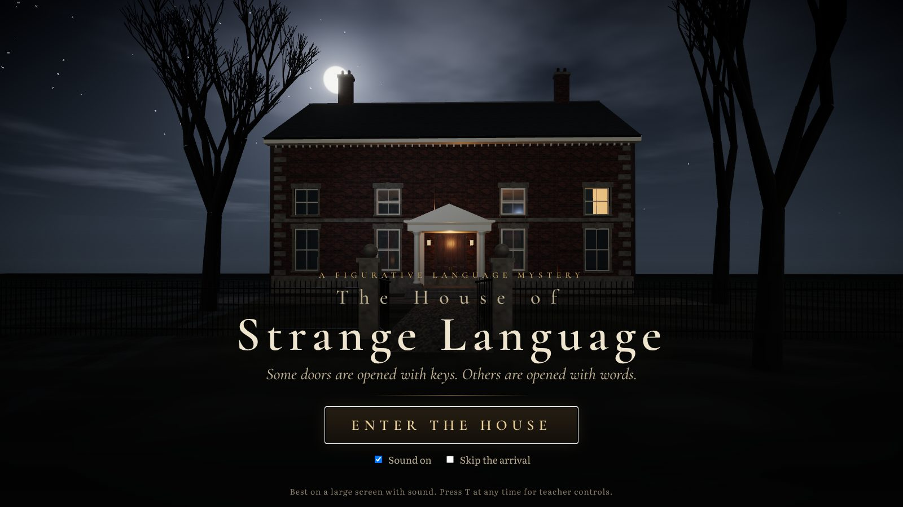 | 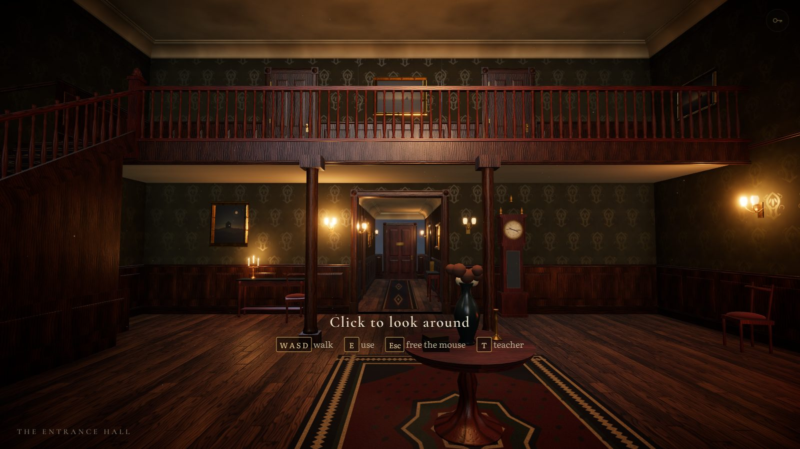 |
| 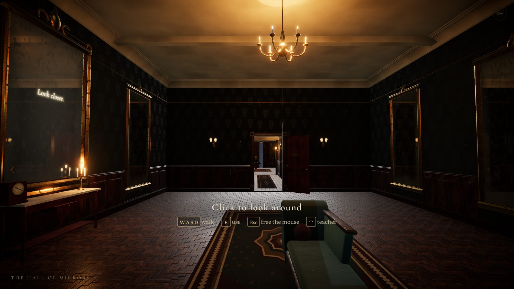 | 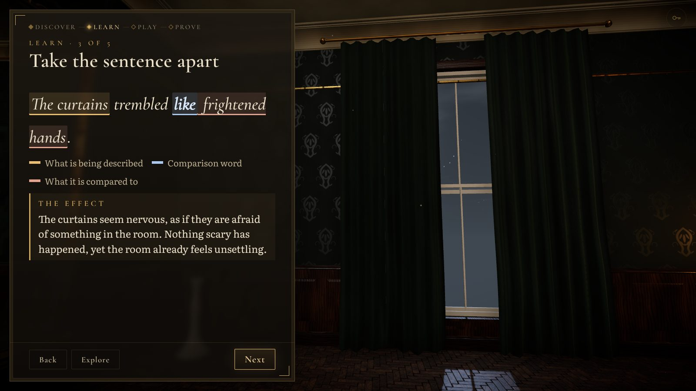 |
| 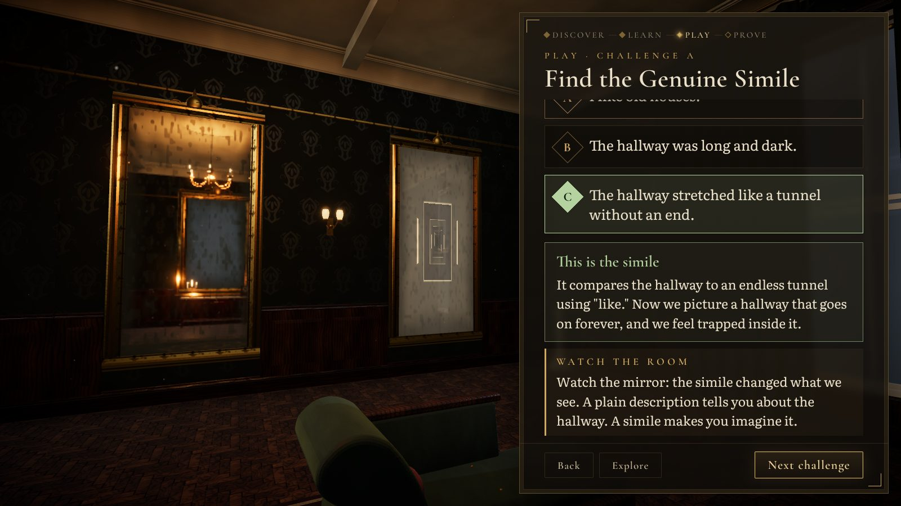 | 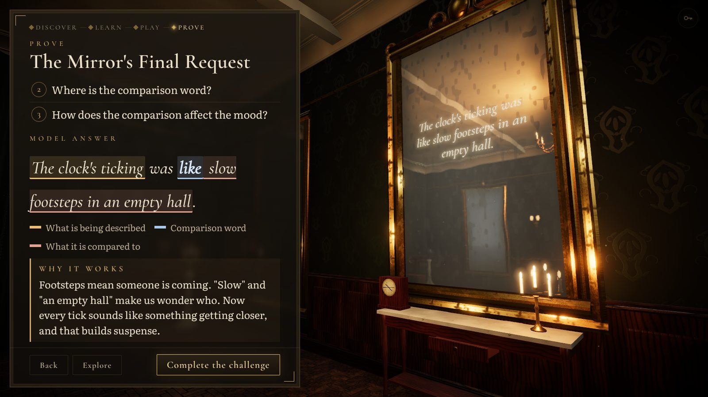 |

Phase 2, captured by `scripts/phase2.mjs`:

| | |
|---|---|
| 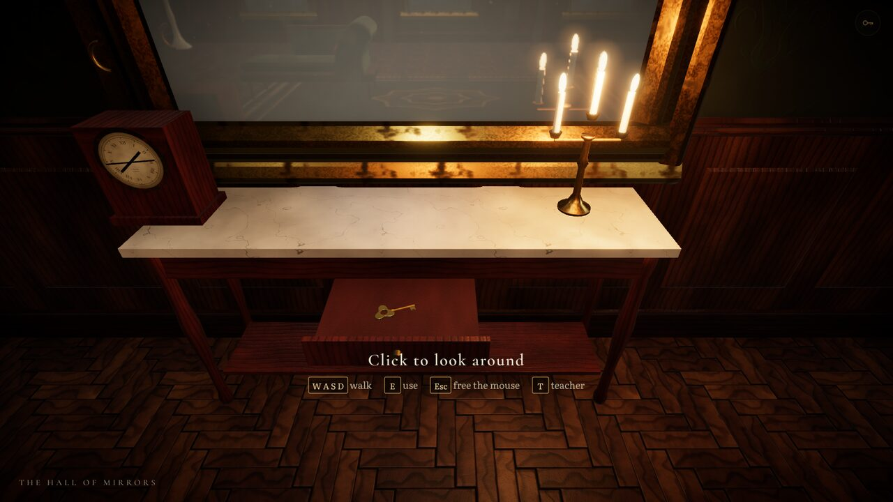 | 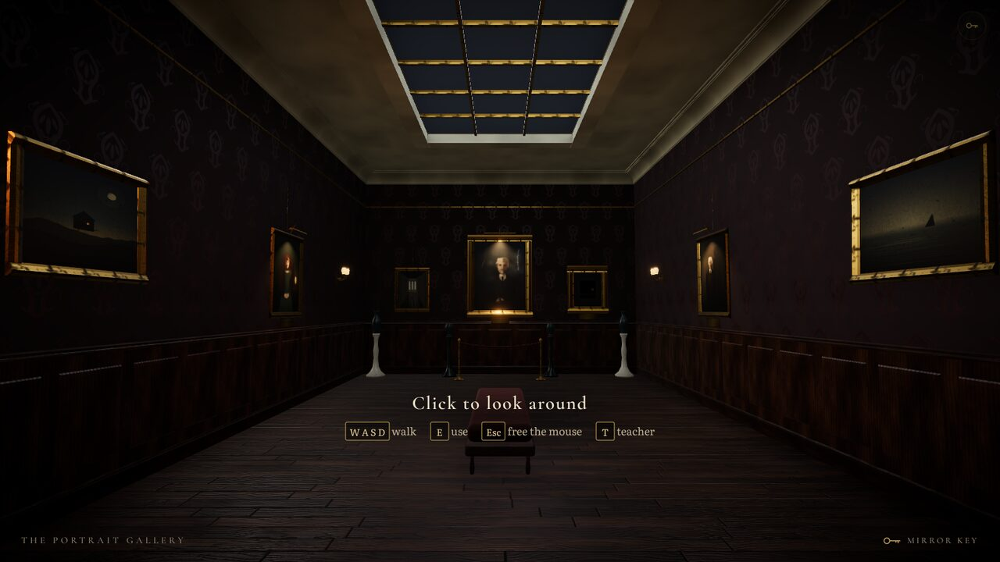 |
| 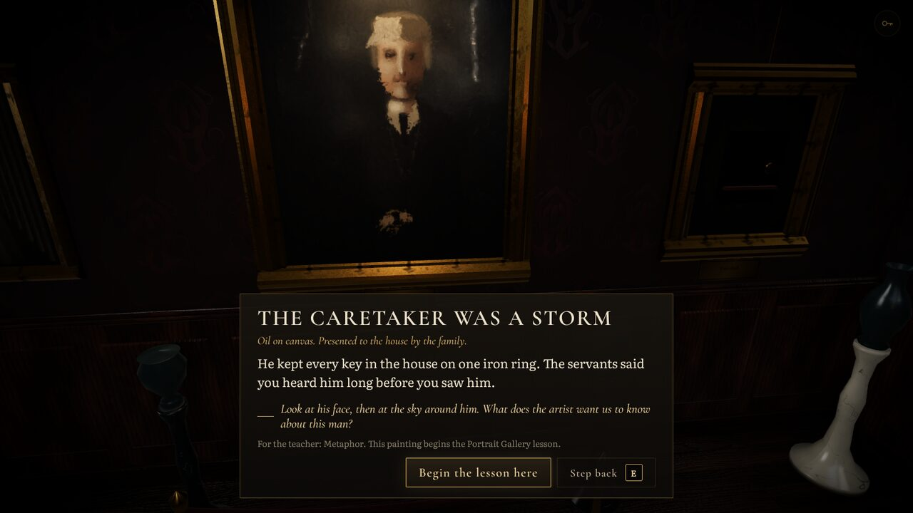 | 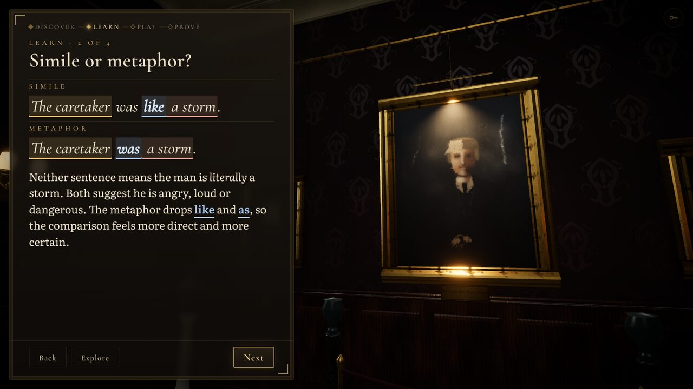 |
| 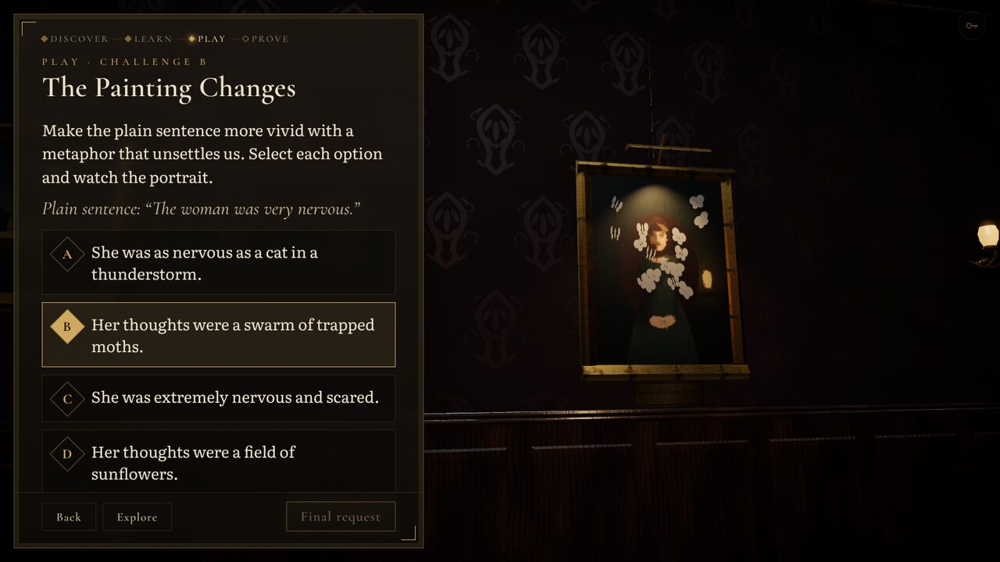 | 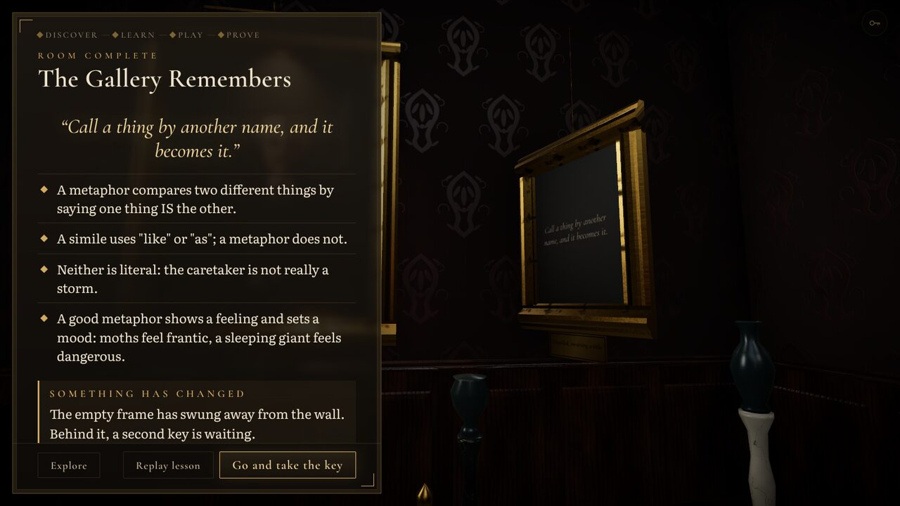 |
